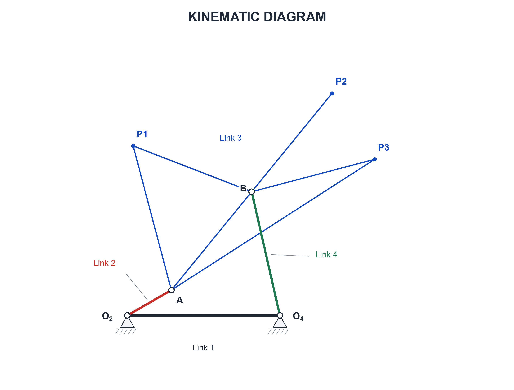
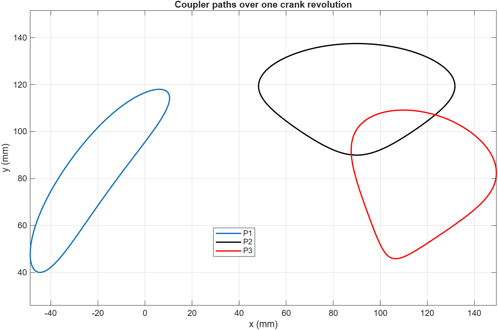

# Couple Curve Mechanism

## Project overview

Project name: Couple Curve Mechanism

Team: นักรบมังกรคนสุดท้าย

Group Members:

| Name | Student ID |
|---|---|
| Chaiyasit Thirayansit | 6730111821 |
| Thanaphon Wongsitthinont | 6730209721 |
| Chayanan Vongsawasdi | 6730087421 |

## Repository structure

| Path | Purpose |
|---|---|
| Simulation/ | Models, scripts, assumptions, and simulation results |
| Picture/ | Pictures used in this README |
| Animation/ | Animations used in this README |

## Part I: Basics including kinematic diagram, DoF analysis

### 1.1. Kinematic Diagram

*Figure 1. Kinematic diagram of coupler curve mechanism*

**Link Identification**

| Link | Element |
|---|---|
| 1 | Ground O2–O4 |
| 2 | Input O2–A |
| 3 | Coupler A–B, carrying P1–P3 |
| 4 | Output O4–B |

**Joint Identification**

| Joint | Joint type | Classification |
|---|---|---|
| O2 | Revolute | Lower pair (J1) |
| A | Revolute | Lower pair (J1) |
| B | Revolute | Lower pair (J1) |
| O4 | Revolute | Lower pair (J1) |

### 1.2. Degrees of Freedom and Grashof Analysis

For a planar mechanism, the Grübler–Kutzbach criterion is

$$
DoF=3(N-1)-2J_1-J_2
$$

where N is the number of links including the ground, J1 is the number
of one-DOF joints, and J2 is the number of two-DOF joints.

For this mechanism,

$$
N=4,\qquad J_1=4,\qquad J_2=0
$$

$$
DoF=3(4-1)-2(4)-0=\boxed{1}.
$$

### 1.3.  Grashof Analysis

The Grashof condition for a planar four-bar linkage is

$$
s+l\leq p+q
$$

where s and l are the shortest and longest link lengths, and p and q
are the remaining two lengths.

| Symbol | Corresponding link | Length |
|---|---|---|
| s | l2 | 30 mm |
| l | l1 | 90 mm |
| p | l3 | 75 mm |
| q | l4 | 75 mm |

Substituting the dimensions gives

$$
s+l=30+90=120\ \text{mm}
$$

$$
p+q=75+75=150\ \text{mm}
$$

$$
120<150.
$$

The linkage satisfies the strict Grashof condition. Since the ground
is adjacent to the shortest link, the selected inversion is a
crank–rocker mechanism. Link 2 can rotate continuously through 360°,
while Link 4 oscillates about O4.

## Part II: Symbolic Math for the Selected Mechanism

### 2.1. MATLAB Kinematic Simulation

MATLAB Symbolic Math Toolbox was used to determine the paths traced
by P1, P2, and P3 on the coupler of a planar four-bar linkage.
The model consists of the fixed link O2–O4, input crank O2–A,
coupler A–B, and output rocker O4–B.

| Parameter | Description | Value |
|---|---|---|
| l1 | Fixed-pivot distance O2–O4 | 90 mm |
| l2 | Input crank length O2–A | 30 mm |
| l3 | Coupler length A–B | 75 mm |
| l4 | Output rocker length O4–B | 75 mm |
| O2 | Input fixed pivot | (0, 0) mm |
| O4 | Output fixed pivot | (90, 0) mm |
| theta2 | Input crank angle | 0–360° |
| omega2 | Constant input angular velocity | 1 rad/s |

The loop-closure equations were solved symbolically and evaluated
at 360 crank angles with a 1° increment. A consistent assembly branch
was selected, with joint B above the fixed link at the initial position.

The animation shows the linkage motion and tracing points.
The x–y plots describe the generated paths, while the position vs
crank-angle plots show each point's coordinates throughout one revolution.

*Video 1. MATLAB animation showing the linkage and synchronized position plots.*

### 2.2. Governing Equations and Position Analysis

**Joint coordinates and loop closure**

The origin is located at O2, with the positive x-axis directed toward O4.
Angles theta2 and theta3 are measured from the positive x-axis.
The model defines theta4 from the negative x-axis toward the positive
y-direction.

The joint coordinates are

$$
A_x=l_2\cos\theta_2,\qquad A_y=l_2\sin\theta_2
$$

$$
B_x=l_1-l_4\cos\theta_4,\qquad B_y=l_4\sin\theta_4.
$$

The rigid coupler imposes the loop-closure equations

$$
l_2\cos\theta_2+l_3\cos\theta_3+l_4\cos\theta_4-l_1=0
$$

$$
l_2\sin\theta_2+l_3\sin\theta_3-l_4\sin\theta_4=0.
$$

For each prescribed theta2, these equations determine theta3 and theta4.

**Coupler-point positions**

Each tracing point has a fixed distance APi from A and an angular
offset betai relative to the coupler direction. Their construction is

$$
\beta_i=90^\circ-\frac{\gamma_i}{2},
\qquad AP_i=2l_3\cos\beta_i.
$$

| Point | gamma_i | beta_i | AP_i |
|---|---|---|---|
| P1 | 72° | 54° | 88.168 mm |
| P2 | 180° | 0° | 150.000 mm |
| P3 | 216° | −18° | 142.658 mm |

The global coordinates are

$$
P_{x_i}=A_x+AP_i\cos(\theta_3+\beta_i)
$$

$$
P_{y_i}=A_y+AP_i\sin(\theta_3+\beta_i).
$$

The offsets beta_i are converted to radians for evaluation in MATLAB.
Plotting Pyi against Pxi over theta2 = 0–360° produces the coupler curves.

*Figure 2. Paths traced by P1, P2, and P3 during one complete input-crank revolution.*

## Part III: Simscape Multibody

## Part IV: Built Mechanism
4.1. Physical Prototype Dimensions

The physical prototype was scaled up from the simulation model so that the parts are easier to print, assemble and handle by hand.

Variable	Link	Colour in Physical Prototype	Pin-to-Pin Length
g	Link 1: Ground	Blue base stand	100 mm ($O_2$–$O_4$)
a	Link 2: Crank Disc	White disc (+ black grip handle on pin $A$)	50 mm ($O_2$–$A$, disc $r$ = 67.5 mm)
b	Link 3: Coupler	Green bar	150 mm ($A$–$B$)
c	Link 4: Rocker	Red bar (orange in Simscape)	140 mm ($O_4$–$B$)

Grashof check for the prototype

$$s + l = 50 + 150 = 200 \text{ mm}, \qquad p + q = 100 + 140 = 240 \text{ mm}$$
$$200 < 240$$

The prototype still satisfies the strict Grashof condition, and the shortest link (crank $a$) is adjacent to the ground, so it remains a crank–rocker: the white disc turns a full 360° while the red rocker oscillates about $O_4$.

Note: Only pin-to-pin lengths matter kinematically. The outer shape of each part (disc radius, bar width, rounded ends) was chosen for strength and appearance and does not change the motion.

4.2. Design for 3D Printing

All links were modelled in CAD and printed with an FDM 3D printer. The design rules below were used so that the printed parts fit together without post-machining.

4.2.1. Link geometry
Part	Design feature	Reason
Ground (blue)	Wide flat base with two raised bosses at $O_2$ and $O_4$	Keeps the mechanism stable on the table; bosses lift the moving links above the base so they do not rub on it
Crank disc (white)	Solid disc ($r$ = 67.5 mm) with the shaft hole at $O_2$ and pin hole at $A$ 50 mm from the centre	A disc is stiffer than a thin bar, adds a little flywheel effect for smoother turning, and gives space for the black grip handle
Coupler (green)	Straight bar with rounded ends and holes at $A$ and $B$	Rounded ends ($R$ ≥ hole radius + 4 mm) leave enough wall around each hole so the plastic does not split
Rocker (red)	Straight bar with holes at $O_4$ and $B$	Same end design as the coupler
4.2.2. Layer (stacking) arrangement

Because the crank rotates through 360°, the links must sit on different planes so they can pass over each other without colliding:

        ┌──────────── coupler (green)  ── top layer
   A ───┤
        └──────────── crank disc (white)
  O2 ─── ground (blue)

        ┌──────────── coupler (green)
   B ───┤
        └──────────── rocker (red)
  O4 ─── ground (blue)

Thin printed spacers/washers (about 1 mm) are placed between links at every joint to reduce friction between flat plastic faces.

4.2.3. Hole clearance and tolerances

FDM printers usually print holes slightly smaller than modelled, so clearance was added in CAD:

Fit	Modelled hole diameter	Purpose
Rotating joint (link turns on shaft)	Shaft Ø + 0.3 to 0.4 mm	Free rotation with little play
Fixed joint (shaft held in ground/boss)	Shaft Ø + 0.0 to 0.1 mm	Press fit, shaft does not turn

A small test print with several hole sizes was made first to find the right clearance for our printer before printing the full links.

4.2.4. Print settings
Setting	Value used	Reason
Material	PLA	Easy to print, stiff enough for a hand-driven model
Layer height	0.2 mm	Good balance between print time and accuracy
Walls / perimeters	3–4	Extra material around the holes, where the load is
Infill	20–30 % (gyrid or grid)	Light but stiff links
Orientation	Flat on the bed (largest face down)	Layers run along the length of each bar, so the bar is not loaded across weak layer lines; holes come out round
Supports	None	All parts are flat, so no overhangs

After printing, the holes were cleaned with a drill bit of the shaft size to remove stringing and the elephant-foot lip on the first layer.

4.3. Assembly with Shafts and Retaining Rings
4.3.1. Parts List

3D-printed parts

No.	Part	Colour	Qty	Material	Key dimensions	Function
1	Ground / base stand	Blue	1	PLA	$O_2$–$O_4$ = 100 mm	Holds the two fixed pivots
2	Crank disc	White	1	PLA	$O_2$–$A$ = 50 mm, $r$ = 67.5 mm	Input link, rotates 360°
3	Coupler	Green	1	PLA	$A$–$B$ = 150 mm	Carries the tracing points $P_1$–$P_3$
4	Rocker	Red	1	PLA	$O_4$–$B$ = 140 mm	Output link, oscillates about $O_4$
5	Grip handle	Black	1	PLA	—	Turns the crank by hand, mounted on pin $A$
6	Spacer / washer	—	4	PLA	≈ 1 mm thick	Separates link layers at each joint

Hardware

No.	Part	Qty	Specification	Used at
7	Steel shaft (pin)	4	Ø5 mm, with retaining-ring groove(s)	$O_2$, $A$, $B$, $O_4$
8	External retaining ring	6	DIN 471, for Ø5 mm shaft	1 each at $O_2$ and $O_4$, 2 each at $A$ and $B$

Parts at each joint

Joint	Shaft	Links on the shaft (bottom → top)	Spacers	Retaining rings
$O_2$	1	Ground → Crank disc	1	1
$O_4$	1	Ground → Rocker	1	1
$A$	1	Crank disc → Coupler → Grip handle	1	2
$B$	1	Rocker → Coupler	1	2
4.3.2. Why shafts and retaining rings?

Printed plastic pins wear quickly and can snap under bending. Using steel shafts at every joint gives:

a smooth, round bearing surface, so the joints turn with low friction and little backlash;
much higher bending strength than a printed pin;
the ability to take the mechanism apart and replace a link.

A retaining ring snaps into a groove cut near the end of the shaft. It stops the links from sliding off the shaft along its axis while still letting them rotate freely. Compared with glue or a press fit, it is easy to remove for disassembly.

4.3.3. Shaft and groove design

Each shaft has a groove for the retaining ring at the end(s) where the links must be held:

   retaining ring
        ▼
  ══════╪════════════════════╪══════   ← steel shaft
        │  link │ spacer │ link │
        groove                groove
Parameter	Value (for a Ø5 mm shaft, DIN 471 ring)
Shaft diameter $d_1$	5.0 mm
Groove diameter $d_2$	4.8 mm
Groove width $m$	0.7 mm
Shaft length	total thickness of the link stack + spacers + ≈ 0.5 mm axial play + ring width

The groove position is set so that the stack is held snug but not clamped; about 0.3–0.5 mm of axial play is left so the links can still turn freely.

4.3.4. Assembly procedure
Ground pivots $O_2$ and $O_4$: press the shafts into the bosses of the blue base (tight fit).
Crank: slide the white crank disc onto the $O_2$ shaft, add a spacer, and fit a retaining ring into the groove.
Rocker: slide the red rocker onto the $O_4$ shaft, add a spacer, and fit a retaining ring.
Joint $A$: insert a shaft through the crank disc at $A$ and the green coupler, with a spacer in between. Fit a retaining ring on each end. Mount the black grip handle on the outer end of this pin.
Joint $B$: insert a shaft through the coupler and the rocker at $B$, with a spacer in between, and fit retaining rings on both ends.
Check: turn the handle slowly through a full revolution. The disc should rotate 360° and the rocker should swing back and forth with no binding or link collision. If a joint is tight, ream the hole slightly or move the groove to add axial play.
4.3.5. Finished prototype
<!-- TODO: add photo of the finished mechanism here -->

Figure 3. Assembled coupler-curve mechanism.

4.4. Problems Found and Fixes
Problem	Cause	Fix
Holes too tight after printing	FDM holes shrink slightly	Added 0.3–0.4 mm clearance in CAD; reamed holes with a drill bit
Links rub against each other	Flat faces in contact	Added printed spacers between layers
Links slide along the shaft	No axial restraint	Added retaining rings in shaft grooves
Joint too tight after fitting the ring	Groove too close to the link stack	Moved the groove outward to leave 0.3–0.5 mm axial play

