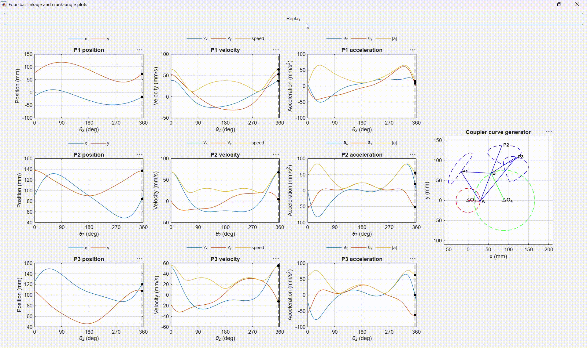
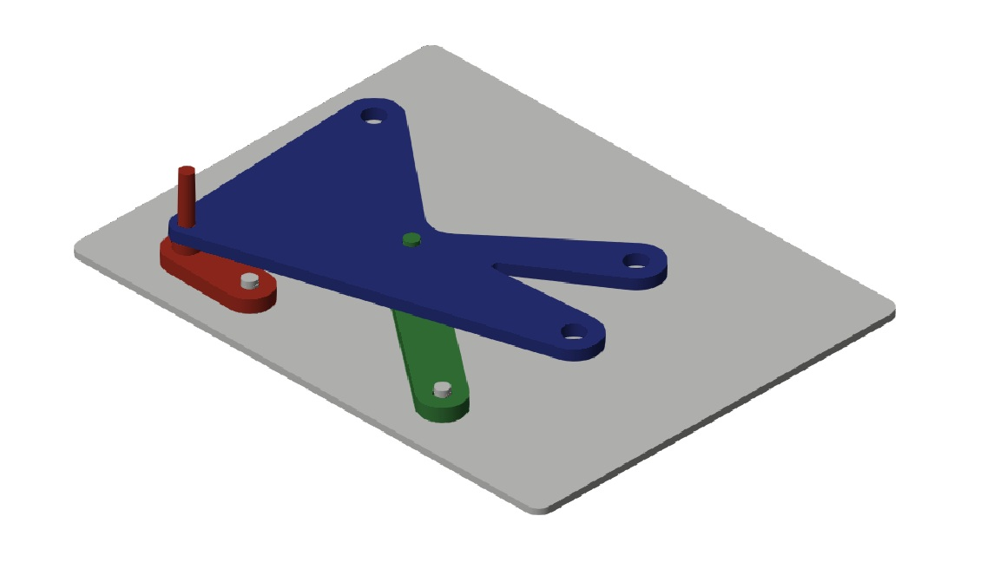
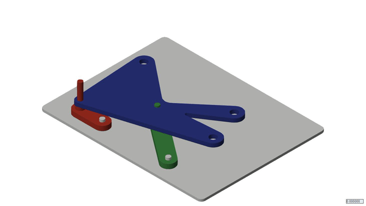
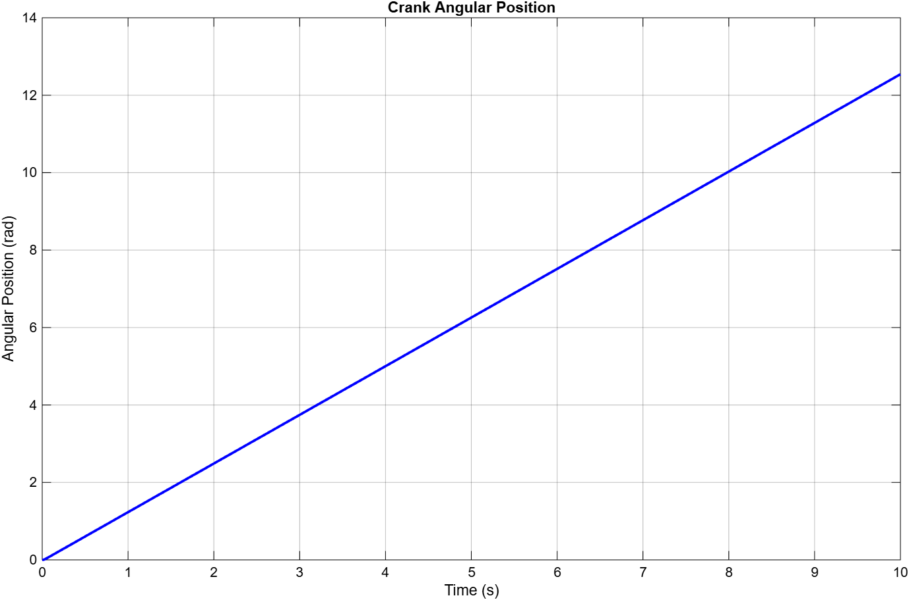
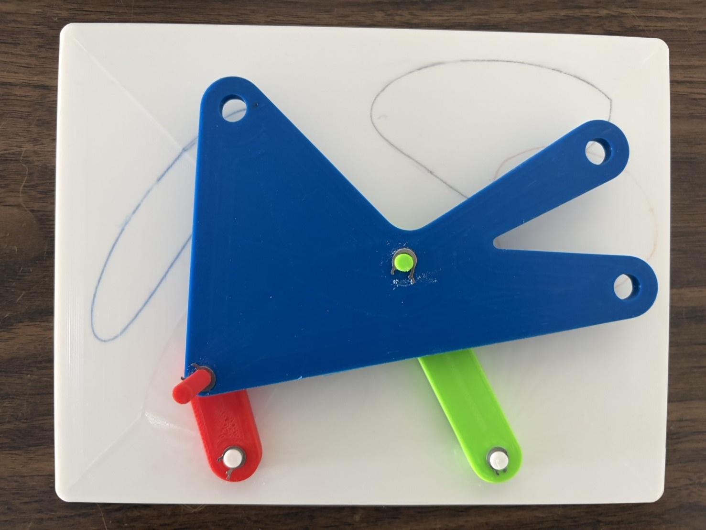

# Coupler Curve Mechanism

## Project overview

Project name: Coupler Curve Mechanism

Team: นักรบมังกรคนสุดท้าย

Group Members:

| Name | Student ID |
|---|---|
| Chaiyasit Thirayansit | 6730111821 |
| Thanaphon Wongsitthinont | 6730209721 |
| Chayanan Vongsawasdi | 6730087421 |

## Repository structure

| Path | Purpose |
|---|---|
| Simulation/ | Models, scripts, assumptions, and simulation results |
| Picture/ | Pictures used in this README |
| Animation/ | Animations used in this README |

## Part I: Basics including kinematic diagram, DoF analysis

### 1.1. Kinematic Diagram

*Figure 1. Kinematic diagram of coupler curve mechanism*

**Link Identification**

| Link | Element |
|---|---|
| 1 | Ground O2–O4 |
| 2 | Input O2–A |
| 3 | Coupler A–B, carrying P1–P3 |
| 4 | Output O4–B |

**Joint Identification**

| Joint | Joint type | Classification |
|---|---|---|
| O2 | Revolute | Lower pair (J1) |
| A | Revolute | Lower pair (J1) |
| B | Revolute | Lower pair (J1) |
| O4 | Revolute | Lower pair (J1) |

### 1.2. Degrees of Freedom

For a planar mechanism, the Grübler–Kutzbach criterion is

$$
DoF=3(N-1)-2J_1-J_2
$$

where N is the number of links including the ground, J1 is the number
of one-DOF joints, and J2 is the number of two-DOF joints.

For this mechanism,

$$
N=4,\qquad J_1=4,\qquad J_2=0
$$

$$
DoF=3(4-1)-2(4)-0=\boxed{1}.
$$

### 1.3.  Grashof Analysis

The Grashof condition for a planar four-bar linkage is

$$
s+l\leq p+q
$$

where s and l are the shortest and longest link lengths, and p and q
are the remaining two lengths.

| Symbol | Corresponding link | Length |
|---|---|---|
| s | l2 | 30 mm |
| l | l1 | 90 mm |
| p | l3 | 75 mm |
| q | l4 | 75 mm |

Substituting the dimensions gives

$$
s+l=30+90=120\ \text{mm}
$$

$$
p+q=75+75=150\ \text{mm}
$$

$$
120<150.
$$

The linkage satisfies the strict Grashof condition. Since the ground
is adjacent to the shortest link, the selected inversion is a
crank–rocker mechanism. Link 2 can rotate continuously through 360°,
while Link 4 oscillates about O4.

## Part II: Symbolic Math for the Selected Mechanism

### 2.1. MATLAB Kinematic Simulation

MATLAB Symbolic Math Toolbox was used to determine the paths traced
by P1, P2, and P3 on the coupler of a planar four-bar linkage.
The model consists of the fixed link O2–O4, input crank O2–A,
coupler A–B, and output rocker O4–B.

| Parameter | Description | Value |
|---|---|---|
| l1 | Fixed-pivot distance O2–O4 | 90 mm |
| l2 | Input crank length O2–A | 30 mm |
| l3 | Coupler length A–B | 75 mm |
| l4 | Output rocker length O4–B | 75 mm |
| O2 | Input fixed pivot | (0, 0) mm |
| O4 | Output fixed pivot | (90, 0) mm |
| theta2 | Input crank angle | 0–360° |
| omega2 | Constant input angular velocity | 1 rad/s |

The loop-closure equations were solved symbolically and evaluated
at 360 crank angles with a 1° increment. A consistent assembly branch
was selected, with joint B above the fixed link at the initial position.

The animation shows the linkage motion and tracing points.
The x–y plots describe the generated paths, while the position vs
crank-angle plots show each point's coordinates throughout one revolution.

*Video 1. MATLAB animation showing the linkage and synchronized position plots.*

### 2.2. Governing Equations and Position Analysis

**Joint coordinates and loop closure**

The origin is located at O2, with the positive x-axis directed toward O4.
Angles theta2 and theta3 are measured from the positive x-axis.
The model defines theta4 from the negative x-axis toward the positive
y-direction.

The joint coordinates are

$$
A_x=l_2\cos\theta_2,\qquad A_y=l_2\sin\theta_2
$$

$$
B_x=l_1-l_4\cos\theta_4,\qquad B_y=l_4\sin\theta_4.
$$

The rigid coupler imposes the loop-closure equations

$$
l_2\cos\theta_2+l_3\cos\theta_3+l_4\cos\theta_4-l_1=0
$$

$$
l_2\sin\theta_2+l_3\sin\theta_3-l_4\sin\theta_4=0.
$$

For each prescribed theta2, these equations determine theta3 and theta4.

**Coupler-point positions**

Each tracing point has a fixed distance APi from A and an angular
offset betai relative to the coupler direction. Their construction is

$$
\beta_i=90^\circ-\frac{\gamma_i}{2},
\qquad AP_i=2l_3\cos\beta_i.
$$

| Point | gamma_i | beta_i | AP_i |
|---|---|---|---|
| P1 | 72° | 54° | 88.168 mm |
| P2 | 180° | 0° | 150.000 mm |
| P3 | 216° | −18° | 142.658 mm |

The global coordinates are

$$
P_{x_i}=A_x+AP_i\cos(\theta_3+\beta_i)
$$

$$
P_{y_i}=A_y+AP_i\sin(\theta_3+\beta_i).
$$

The offsets beta_i are converted to radians for evaluation in MATLAB.
Plotting Pyi against Pxi over theta2 = 0–360° produces the coupler curves.

*Figure 2. Paths traced by P1, P2, and P3 during one complete input-crank revolution.*

## Part III: Simscape Multibody

### 3.1 Mechanism Rendering

The four-bar mechanism was modeled using MATLAB Simulink and Simscape Multibody. The CAD components were imported as STEP files.

  

*Figure 3. Isometric view of the assembled four-bar mechanism in Simscape Multibody.*

The assembled model consists of a fixed base (white), crank (red), coupler (blue), and rocker (green). The three pen attachment holes on the coupler are designed to generate different motion trajectories.

### 3.2 Simscape Multibody Model

The four-bar mechanism was constructed using File Solid, Rigid Transform, and Revolute Joint blocks, forming a closed-loop mechanism.

  

*Figure 4. Simscape Multibody block diagram of the Coupler Curve Mechanism, including crank motion input, joint motion outputs, and three position sensors for coupler-curve tracing.*

The Simscape Multibody model was constructed using File Solid, Rigid Transform, Revolute Joint, and Transform Sensor blocks. A ramp input was applied to the crank joint to drive the mechanism. The model also includes three sensing points on the coupler to obtain the x- and y-coordinates used for coupler-curve generation.

### 3.3 Simulation Parameters

| Parameter | Value |
| :--- | :---: |
| Simulation Time | 10 s |
| Ramp Slope | 2*pi/5 rad/s |
| Input Angular Velocity | 1.2566 rad/s |
| Rotation Period | 5 s |
| Nominal Number of Revolutions | 2 |
| Motion Actuation | Provided by Input |
| Torque Actuation | Automatically Computed |
| Input Signal Unit | rad |
| Input Filtering | Second-order |

Rigid Transform blocks were used to align the joint axes and adjust the relative positions of the mechanical components.

### 3.4 Mechanism Animation

  

*Video 2. Simulated motion of the four-bar Coupler Curve Mechanism.*

The animation illustrates the continuous rotation of the crank and the resulting motion of the coupler and rocker. The simulation was performed over 10 seconds, corresponding to approximately two revolutions of the crank.

[Download the original simulation video (.avi)](./Animation/Mechanism.avi)

### 3.5 Position and Coupler Curve Analysis

#### Crank Angular Position

  

*Figure 5. Angular position of the crank over the 10-second simulation.*

The angular position increases approximately linearly from 0 to 12.55 rad, indicating nearly constant rotational speed. The crank completes approximately two revolutions, consistent with the prescribed input motion.

#### Coupler Curves

The trajectories of the three pen attachment points were measured using Transform Sensor blocks relative to the World Frame.

  

*Figure 6. Simulated trajectories of the three pen attachment points on the coupler.*

- **P1 (Blue):** A narrow, inclined closed curve.
- **P2 (Black):** A wide, horizontally oriented closed curve.
- **P3 (Red):** A rounded triangular-like closed curve.

The simulated trajectories show good qualitative agreement with the theoretical results presented in Part II.

### 3.6 Simulation Results and Discussion

The Simscape Multibody simulation successfully demonstrates the continuous motion of the crank-rocker mechanism and its ability to generate three distinct closed trajectories.

The simulated coupler curves show good qualitative agreement with the theoretical results in Part II. The observed horizontal offset of approximately 45 mm is likely due to the different coordinate origins used in the two models.

These results support the kinematic consistency of the mechanism.

#### Simulation Files

[Simulink Model and STEP Files](./Simulation)

## Part IV: Built Mechanism

### 4.1. Physical Prototype Dimensions

*Figure 7. Fusion 360 model of the built mechanism.*

| Variable | Link | Colour in Physical Prototype | Length |
|:---:|---|---|:---:|
| `g` | **Link 1: Ground** | White base plate | 90 mm  |
| `a` | **Link 2: Crank** | Green bar | 30 mm  |
| `b` | **Link 3: Coupler** | Blue triangular plate with holes at $P_1\text{–}P_3$ | 75 mm  |
| `c` | **Link 4: Rocker** | Red bar *(orange in Simscape)* | 75 mm  |

Shafts are printed as part of the links, so they are not listed separately. Shaft holes are 6 mm in diameter.

The prototype satisfies the strict Grashof condition, and the shortest link (crank $a$) is adjacent to the ground, so it is a **crank–rocker**: the green crank turns a full 360° while the red rocker oscillates about $O_4$.

---

### 4.2. Design and 3D Printing

All parts were designed in **Fusion 360** and 3D printed with **ABS** material.

The shafts were printed together with the links as single parts. At each joint, the shaft on one link passes through a **6 mm shaft hole** in the mating link, and a retaining ring is fitted on the shaft to stop the links from sliding apart (Retaining ring = diameter 6 mm).

---

### 4.3. Finished Prototype

*Figure 8. Assembled coupler-curve mechanism.*
---
