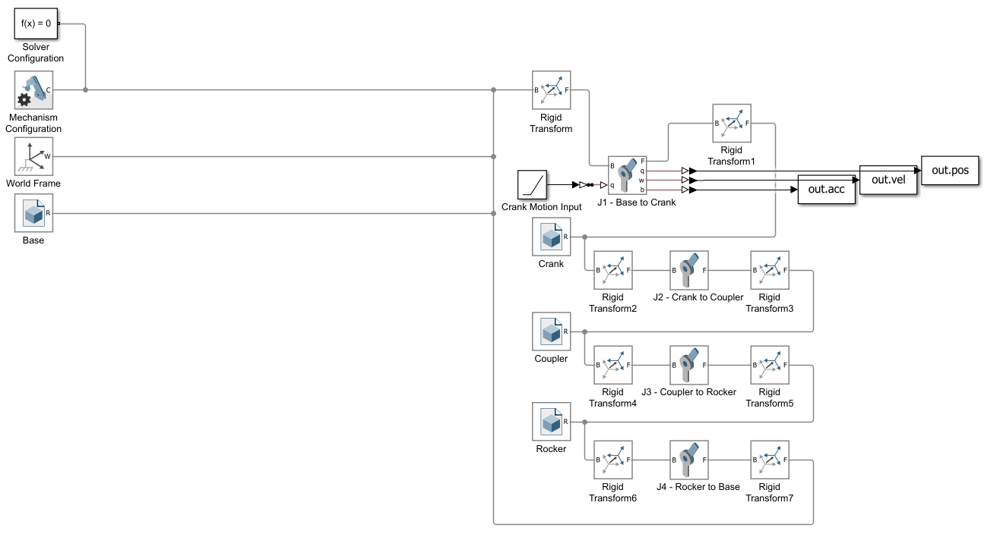
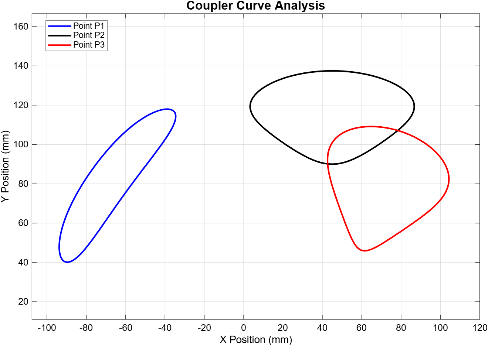
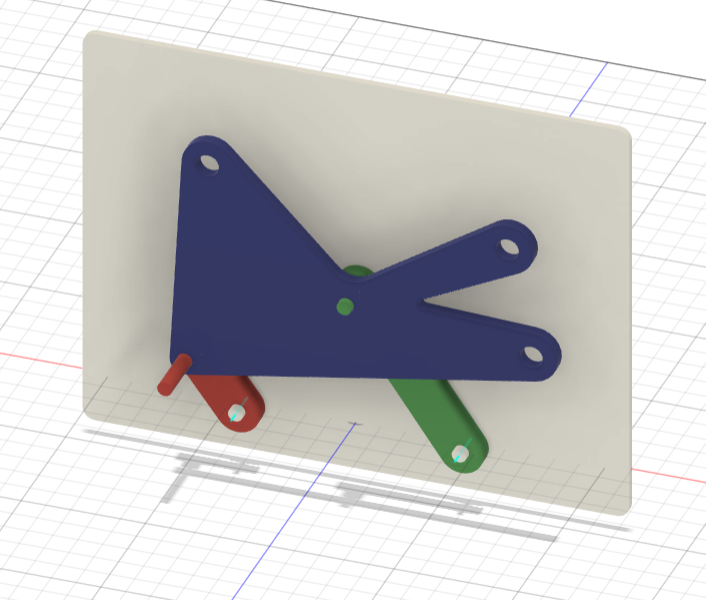

# Couple Curve Mechanism

## Project overview

Project name: Couple Curve Mechanism

Team: นักรบมังกรคนสุดท้าย

Group Members:

| Name | Student ID |
|---|---|
| Chaiyasit Thirayansit | 6730111821 |
| Thanaphon Wongsitthinont | 6730209721 |
| Chayanan Vongsawasdi | 6730087421 |

## Repository structure

| Path | Purpose |
|---|---|
| Simulation/ | Models, scripts, assumptions, and simulation results |
| Picture/ | Pictures used in this README |
| Animation/ | Animations used in this README |

## Part I: Basics including kinematic diagram, DoF analysis

### 1.1. Kinematic Diagram

*Figure 1. Kinematic diagram of coupler curve mechanism*

**Link Identification**

| Link | Element |
|---|---|
| 1 | Ground O2–O4 |
| 2 | Input O2–A |
| 3 | Coupler A–B, carrying P1–P3 |
| 4 | Output O4–B |

**Joint Identification**

| Joint | Joint type | Classification |
|---|---|---|
| O2 | Revolute | Lower pair (J1) |
| A | Revolute | Lower pair (J1) |
| B | Revolute | Lower pair (J1) |
| O4 | Revolute | Lower pair (J1) |

### 1.2. Degrees of Freedom and Grashof Analysis

For a planar mechanism, the Grübler–Kutzbach criterion is

$$
DoF=3(N-1)-2J_1-J_2
$$

where N is the number of links including the ground, J1 is the number
of one-DOF joints, and J2 is the number of two-DOF joints.

For this mechanism,

$$
N=4,\qquad J_1=4,\qquad J_2=0
$$

$$
DoF=3(4-1)-2(4)-0=\boxed{1}.
$$

### 1.3.  Grashof Analysis

The Grashof condition for a planar four-bar linkage is

$$
s+l\leq p+q
$$

where s and l are the shortest and longest link lengths, and p and q
are the remaining two lengths.

| Symbol | Corresponding link | Length |
|---|---|---|
| s | l2 | 30 mm |
| l | l1 | 90 mm |
| p | l3 | 75 mm |
| q | l4 | 75 mm |

Substituting the dimensions gives

$$
s+l=30+90=120\ \text{mm}
$$

$$
p+q=75+75=150\ \text{mm}
$$

$$
120<150.
$$

The linkage satisfies the strict Grashof condition. Since the ground
is adjacent to the shortest link, the selected inversion is a
crank–rocker mechanism. Link 2 can rotate continuously through 360°,
while Link 4 oscillates about O4.

## Part II: Symbolic Math for the Selected Mechanism

### 2.1. MATLAB Kinematic Simulation

MATLAB Symbolic Math Toolbox was used to determine the paths traced
by P1, P2, and P3 on the coupler of a planar four-bar linkage.
The model consists of the fixed link O2–O4, input crank O2–A,
coupler A–B, and output rocker O4–B.

| Parameter | Description | Value |
|---|---|---|
| l1 | Fixed-pivot distance O2–O4 | 90 mm |
| l2 | Input crank length O2–A | 30 mm |
| l3 | Coupler length A–B | 75 mm |
| l4 | Output rocker length O4–B | 75 mm |
| O2 | Input fixed pivot | (0, 0) mm |
| O4 | Output fixed pivot | (90, 0) mm |
| theta2 | Input crank angle | 0–360° |
| omega2 | Constant input angular velocity | 1 rad/s |

The loop-closure equations were solved symbolically and evaluated
at 360 crank angles with a 1° increment. A consistent assembly branch
was selected, with joint B above the fixed link at the initial position.

The animation shows the linkage motion and tracing points.
The x–y plots describe the generated paths, while the position vs
crank-angle plots show each point's coordinates throughout one revolution.

*Video 1. MATLAB animation showing the linkage and synchronized position plots.*

### 2.2. Governing Equations and Position Analysis

**Joint coordinates and loop closure**

The origin is located at O2, with the positive x-axis directed toward O4.
Angles theta2 and theta3 are measured from the positive x-axis.
The model defines theta4 from the negative x-axis toward the positive
y-direction.

The joint coordinates are

$$
A_x=l_2\cos\theta_2,\qquad A_y=l_2\sin\theta_2
$$

$$
B_x=l_1-l_4\cos\theta_4,\qquad B_y=l_4\sin\theta_4.
$$

The rigid coupler imposes the loop-closure equations

$$
l_2\cos\theta_2+l_3\cos\theta_3+l_4\cos\theta_4-l_1=0
$$

$$
l_2\sin\theta_2+l_3\sin\theta_3-l_4\sin\theta_4=0.
$$

For each prescribed theta2, these equations determine theta3 and theta4.

**Coupler-point positions**

Each tracing point has a fixed distance APi from A and an angular
offset betai relative to the coupler direction. Their construction is

$$
\beta_i=90^\circ-\frac{\gamma_i}{2},
\qquad AP_i=2l_3\cos\beta_i.
$$

| Point | gamma_i | beta_i | AP_i |
|---|---|---|---|
| P1 | 72° | 54° | 88.168 mm |
| P2 | 180° | 0° | 150.000 mm |
| P3 | 216° | −18° | 142.658 mm |

The global coordinates are

$$
P_{x_i}=A_x+AP_i\cos(\theta_3+\beta_i)
$$

$$
P_{y_i}=A_y+AP_i\sin(\theta_3+\beta_i).
$$

The offsets beta_i are converted to radians for evaluation in MATLAB.
Plotting Pyi against Pxi over theta2 = 0–360° produces the coupler curves.

*Figure 2. Paths traced by P1, P2, and P3 during one complete input-crank revolution.*

## Part III: Simscape Multibody

### 3.1 Model Overview

The Coupler Curve Mechanism was modeled and simulated using MATLAB Simulink and Simscape Multibody.

The mechanism consists of four rigid links connected by four revolute joints, forming a planar four-bar linkage. The rotation of the crank generates three different trajectories at the selected pen positions on the coupler.

### 3.2 CAD Model and Link Dimensions

The mechanical components were designed in Autodesk Fusion 360 and exported as STEP files.

| Link | Component | Color | Length |
| :---: | :--- | :---: | :---: |
| 1 | Ground (Base) | White | 90 mm |
| 2 | Crank | Red | 30 mm |
| 3 | Coupler | Blue | 75 mm |
| 4 | Rocker | Green | 75 mm |

The mechanism has one degree of freedom (DOF).

#### Mechanism Rendering

*Figure 3. Isometric view of the assembled mechanism.*

### 3.3 Simscape Multibody Model

The four-bar linkage was constructed in Simscape Multibody using CAD models imported from Autodesk Fusion 360.

The simulation model consists of:

- 4 File Solid blocks
- 8 Rigid Transform blocks
- 4 Revolute Joint blocks
- World Frame
- Mechanism Configuration
- Solver Configuration
- Ramp
- Simulink-PS Converter
- Transform Sensor

The four revolute joints connect the ground, crank, coupler, and rocker to form a closed-loop mechanism.

The crank is driven by a prescribed angular displacement generated by the Ramp block. The remaining links move according to the constraints of the four-bar linkage.

#### Simscape Multibody Block Diagram

  

  <em>Figure 4. Simscape Multibody model of the Coupler Curve Mechanism.</em>

### 3.4 Simulation Parameters

The crank is driven by a prescribed angular displacement using a Ramp block.

| Parameter | Value |
| :--- | :---: |
| Simulation Time | 10 s |
| Ramp Slope | 2*pi/5 |
| Angular Velocity | 1.2566 rad/s |
| Angular Velocity | 72 deg/s |
| Rotation Period | 5 s |
| Nominal Number of Revolutions | 2 |
| Nominal Input Rotation | 720 deg |
| Motion Actuation | Provided by Input |
| Torque Actuation | Automatically Computed |
| Input Signal Unit | rad |
| Input Filtering | Second-order filtering |

### 3.5 Rigid Transform Configuration

The Rigid Transform blocks define the connection frames of the four-bar linkage.

| Block | Translation Offset (mm) |
| :--- | :---: |
| Rigid Transform | [-45 0 8] |
| Rigid Transform1 | [-30 0 -4] |
| Rigid Transform2 | [0 0 16] |
| Rigid Transform3 | [0 0 -5] |
| Rigid Transform4 | [75 0 5] |
| Rigid Transform5 | [37.5 0 -16] |
| Rigid Transform6 | [37.5 0 10] |
| Rigid Transform7 | [-45 0 -14] |

The axial positions were adjusted to obtain the desired assembly configuration and reduce geometric interference.

### 3.6 Mechanism Animation

The motion of the four-bar linkage was simulated and visualized using Simscape Multibody Explorer.

The animation demonstrates the rotation of the crank and the resulting motion of the coupler and rocker.

  

  <em>Video 2. Animation of the Coupler Curve Mechanism.</em>

[Download Original Mechanism Animation (.avi)](./Animation/Mechanism.avi)

### 3.7 Position Analysis

The angular position of the crank was obtained from the Revolute Joint sensing output in Simscape Multibody.

The simulation was performed over a period of 10 seconds.

#### Angular Position

  

The angular position increases approximately linearly from 0 to 12.55 rad, corresponding to approximately two complete revolutions of the crank.

The result demonstrates the continuous rotation of the input link and provides a reference for the coupler curve analysis.

### 3.8 Coupler Curve Analysis

Three pen attachment positions were selected on the coupler to generate three different motion trajectories.

| Point | X (mm) | Y (mm) | Z (mm) |
| :---: | :---: | :---: | :---: |
| P1 | 51.824 | 71.329 | 5 |
| P2 | 150.000 | 0.000 | 5 |
| P3 | 135.676 | -44.084 | 5 |

The trajectories can be obtained by measuring the global X and Y coordinates of each point using Transform Sensor blocks.

*Figure 3. Motion trajectories of the three selected coupler points.*

### 3.9 Force and Torque Analysis

The driving torque and joint reaction forces can be investigated using the sensing options of the Revolute Joint blocks.

Accurate force analysis requires appropriate mass, material properties, moments of inertia, gravity settings, and loading conditions.

### 3.10 Simulation Results and Discussion

The Simscape Multibody model demonstrates the movement of the four-bar linkage.

The positions of the rigid links and joint frames were adjusted to represent the actual mechanical assembly. The simulation provides a visualization of the relationship between the crank input and the resulting coupler motion.

The simulation results can be compared with the symbolic mathematical analysis and the physical prototype.

### 3.11 Instructions for Running the Simulation

1. Download the Simulink model and all STEP files from the Simulation folder.
2. Place all files in the same directory.
3. Open MATLAB Simulink.
4. Set the Current Folder to the model directory.
5. Open the .slx file.
6. Verify the STEP file references.
7. Set the Stop Time to 10 seconds.
8. Click Run.
9. Visualize the mechanism using Multibody Explorer.
10. Obtain the motion analysis results from the sensing outputs.

## Part IV: Built Mechanism

### 4.1. Physical Prototype Dimensions

*Figure 3. Fusion 360 model of the built mechanism.*

| Variable | Link | Colour in Physical Prototype | Length |
|:---:|---|---|:---:|
| `g` | **Link 1: Ground** | White base plate | 90 mm  |
| `a` | **Link 2: Crank** | Green bar | 30 mm  |
| `b` | **Link 3: Coupler** | Blue triangular plate with holes at $P_1\text{–}P_3$ | 75 mm  |
| `c` | **Link 4: Rocker** | Red bar *(orange in Simscape)* | 75 mm  |

Shafts are printed as part of the links, so they are not listed separately. Shaft holes are 6 mm in diameter.

The prototype satisfies the strict Grashof condition, and the shortest link (crank $a$) is adjacent to the ground, so it is a **crank–rocker**: the green crank turns a full 360° while the red rocker oscillates about $O_4$.

---

### 4.2. Design and 3D Printing

All parts were designed in **Fusion 360** and 3D printed with **ABS** material.

The shafts were printed together with the links as single parts. At each joint, the shaft on one link passes through a **6 mm shaft hole** in the mating link, and a retaining ring is fitted on the shaft to stop the links from sliding apart (Retaining ring = diameter 6 mm).

---

### 4.4. Finished Prototype

<!-- TODO: add photo of the finished mechanism here -->

*Figure 4. Assembled coupler-curve mechanism.*
---
